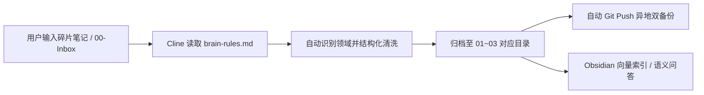

# AI 个人第二大脑 · 通用知识库模板

一套基于 **Markdown + VS Code + Cline + Git** 的轻量级 Agentic RAG 个人第二大脑模板。零数据库开销，数据 100% 本地/私有掌控，可公开分享、可随时 fork 复用。所有文档均为纯 Markdown，配合 Obsidian 等工具可实现语义检索与问答（RAG）；不含任何个人业务数据，可直接公开分享。

> **告别重型向量数据库与复杂的本地环境配置！** 只需纯 Markdown 文件 + VS Code Cline 智能体 + Git，说一句"这是我的学习笔记，你学习一下"，即可实现全自动分类归档、异地双备份与本地语义检索（Agentic RAG）。

> 模板目录与 `01-Tech-Specs` / `02-Troubleshooting` 等历史目录完全解耦，不包含任何个人业务笔记、域名、内网 IP 或密钥，可直接用于公开仓库。

---

## 工作原理一览（Mermaid 架构图）

## 目录结构说明

| 目录 | 作用 |
| --- | --- |
| `00-Inbox/` | 临时草稿、待整理方案，存放新写的文档等待自动归类 |
| `01-Tech-Specs/` | 正式技术方案、架构设计、接口文档等知识沉淀 |
| `02-Troubleshooting/` | 报错记录、踩坑复盘、排错指南 |
| `03-Templates-Prompts/` | 可复用命令速查表、提示词模板、标准化清单 |
| `clinerules/brain-rules.md` | 给 AI 的记忆与训练规则（写作规范、归档标准、自动化 SOP） |

每个分类目录下均附带 `.gitkeep`，保证空目录可被 Git 追踪。

---

## 第一步：安装与部署（二选一）

### 方案 A：一键全自动安装（推荐新手 / 小白）

**Windows 用户**：点击页面右上角 `Code → Download ZIP` 下载压缩包并解压，直接双击运行 `setup.bat`，脚本会自动检测安装 Git、VS Code、Cline 插件并初始化仓库。

**Mac / Linux 用户**：在解压目录终端执行 `chmod +x setup.sh && bash setup.sh` 即可全自动完成配置。

> **提示**：脚本运行结束后会自动弹出 VS Code，你只需在右侧 Cline 面板填入自己的大模型 API Key 即可直接进入"第二步：开始使用"。

### 方案 B：GitHub 模板手动部署（推荐开发者）

- 点击右上角 `Use this template` 创建私有仓库并 `git clone` 到本地；
- 用 VS Code 打开目录，在扩展商店（`Ctrl+Shift+X`）搜索安装 **Cline** 插件并填入 API Key。

---

## 第二步：日常使用指南（零门槛体验）

### 1. 一句话投喂与自动归档

打开 Cline 对话框，直接粘贴笔记并发送 **"这是我的学习笔记，你学习一下"**（或将草稿放入 `00-Inbox/`），AI 会自动识别领域、创建子目录、补充标签、清理收件箱并自动 `git push` 双备份。

### 2. 持续进化你的 AI 规则

按需修改 `clinerules/brain-rules.md` 中的分类偏好与排版规范，AI 会越来越懂你的工作流。

---

## 第三步：进阶扩展（接入 Obsidian 实现本地语义检索与问答）

当你的知识库笔记积累到数百篇以上时，可以让 **Cline（负责自动整理与写入）** 与 **Obsidian（负责可视化阅读与全库语义问答）** 协同工作：

1. **用 Obsidian 打开知识库目录**：
   - 下载并打开 Obsidian，选择 **"打开本地文件夹作为仓库（Open folder as vault）"**，直接选中你克隆下来的 `AI_second_Brain_Template` 根目录（两者共用同一份 Markdown 文件，零迁移成本）。
   - *建议设置*：在 Obsidian 设置 → `文件与链接` 中，关闭或忽略对 `clinerules` 目录的干扰，保持笔记视图清爽。

2. **安装社区语义检索（RAG）插件（任选其一）**：
   - 进入 Obsidian 设置 → `第三方插件`（关闭安全模式）→ 点击 `浏览` 搜索安装：
     - **Smart Connections（推荐，开箱即用）**：自动对全库 Markdown 进行语义切片与本地/云端向量化（Embedding），侧边栏实时推荐"语义最相似的历史笔记"，并支持直接针对全库内容进行 RAG 问答。
     - **Copilot for Obsidian**：支持绑定 OpenAI、DeepSeek、SiliconFlow 或本地 Ollama 模型，输入 `@vault` 即可基于整个知识库进行带引用来源的语义检索问答。

3. **配置向量化（Embedding）与对话模型**：
   - 在插件设置中填入你的大模型 API Key（或配置本地 Ollama 模型的 `nomic-embed-text` 等轻量向量模型），点击触发全库建立向量索引。
   - 索引完成后，后续每次 Cline 自动归档新笔记并 `git push` 后，Obsidian 都会在后台自动增量更新向量坐标。

4. **注意 `.gitignore` 防止插件缓存污染仓库**：
   - 建议将 Obsidian 自动生成的 `.obsidian/` 配置与向量缓存目录加入 `.gitignore`（或仅保留核心快捷键配置），避免每次打开 Obsidian 都产生大量无意义的 Git 变更记录。